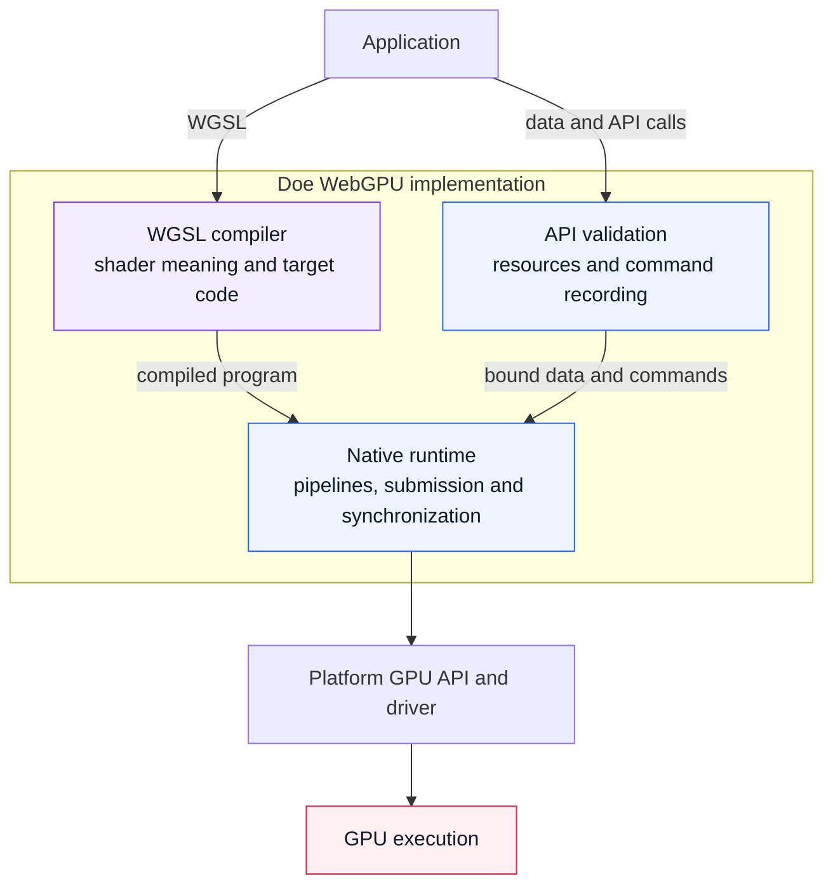
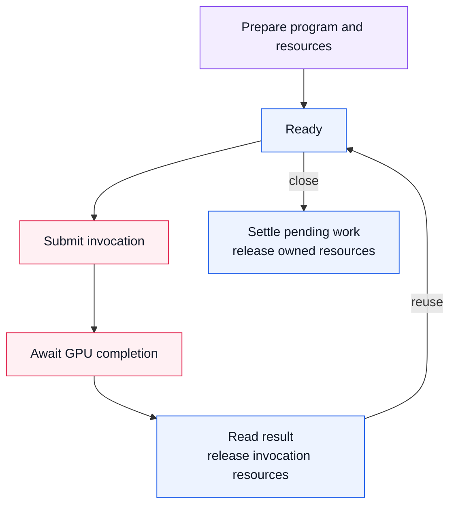

# Doe

A WGSL compiler and native WebGPU runtime for existing GPU applications.
Use either independently. Vulkan is the current engineering focus.

**[Evaluate ONNX on Vulkan](docs/onnx-vulkan-installation.md)** · [Package API](packages/doe-gpu/README.md) · [Documentation](docs/INDEX.md)

## Get started

Install the package and run a compute kernel:

```sh
npm install doe-gpu
node node_modules/doe-gpu/examples/node-first-kernel.mjs
```

Check the [supported configurations](docs/doe-support-matrix.md) for host and
driver requirements. For the pinned ONNX integration, download the existing
[evaluation archive](docs/onnx-vulkan-installation.md#download-the-evaluation)
and follow its installation, verification, and execution guide.

## Technical architecture

### Compiler and runtime ownership

Shader programs and application data meet at GPU execution. The compiler sits
inside Doe's WebGPU implementation and is also independently callable.



Doe owns compilation and execution; applications retain their algorithms and
numerical requirements. Platform drivers remain external dependencies.

### Optional prepared-program resource lifetime

Ordinary WebGPU needs no prepared-program interface. Repeated workloads can
retain compatible resources through [reusable compute programs](docs/reusable-compute-programs.md).



Submission or cancellation does not prove GPU completion. Pending work keeps
the references needed for safe reuse and cleanup. Prepare structural replacements
before activation; failed preparation preserves the working program.

## Evidence

The [ONNX delivery report](reports/releases/20261009-onnx-vulkan-evaluation/README.md)
records bounded SqueezeNet execution and lifecycle checks, including local
isolated installation. Broader compatibility, external reproduction, retained
adoption, and material replacement advantage remain unestablished.

Compiler correctness, runtime performance, and application benefit require
separate evidence. See the [claim index](reports/claim-index.json),
[backend evidence](docs/backend-evidence-matrix.md), and [current status](docs/status.md).
Native results do not qualify browser replacement. Fawn remains a
[retained browser integration](browser/chromium/README.md).

## Read next

- [Architecture](docs/architecture.md) — subsystem boundaries and execution details.
- [Goals](GOALS.md) — independent compiler/runtime adoption and Vulkan priorities.
- [Contributing](AGENTS.md) — repository workflow and component ownership.

## License

[MIT](LICENSE). See [licensing](docs/licensing.md) for third-party boundaries.
