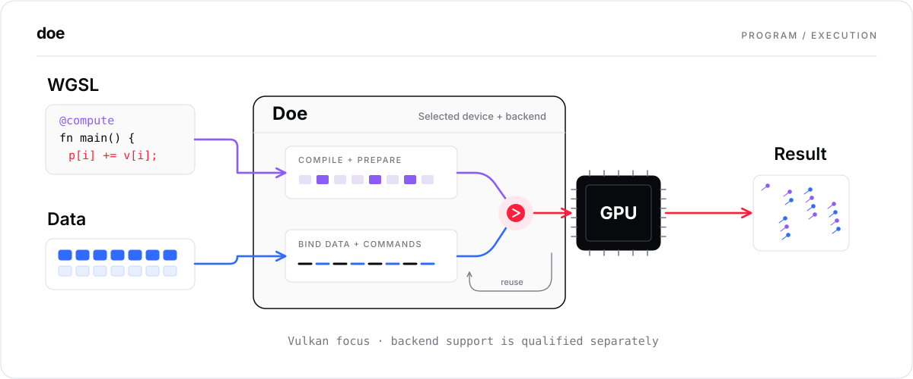
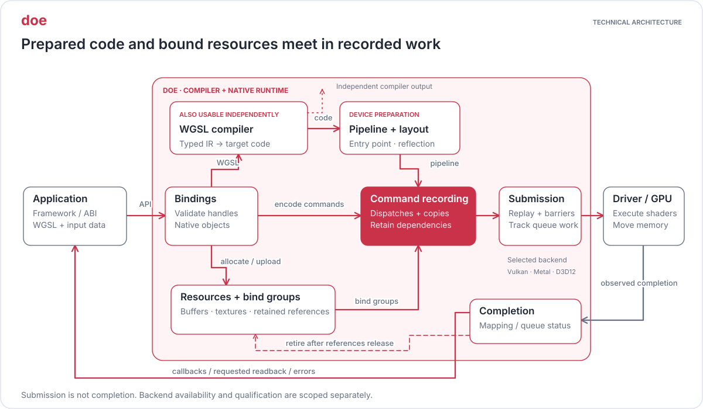

# Fawn

Fawn provides durable browser workspaces for agents. This repository also contains
**Doe**, its independently usable WebGPU runtime and WGSL compiler. DoeLab tests
improvements, and DoeProof records execution and qualification evidence.

The canonical repository for Fawn and Doe is
**[clocksmith/fawn](https://github.com/clocksmith/fawn)**. Doe is a component here,
not a separate current repository. The JavaScript package remains `doe-gpu`.

| Surface | What it does | Start here |
| --- | --- | --- |
| Fawn | Browser observation, authorized actions, handoff and recovery | [Workspace service](browser/workspace/README.md) |
| Doe | Native WebGPU execution and WGSL compilation | [Runtime](runtime/c/README.md) · [Compiler](runtime/c/compiler/README.md) · [Package API](packages/doe-gpu/README.md) |
| GPU demos | Artwork rendered by the active browser backend | [Canvas demos](https://canvascontext.com/) · [Source](browser/chromium/resources/) |

Fawn's shared
workspace service is implemented and behaviorally qualified on a frozen case set,
not release-qualified ([status](docs/status/fawn-workspace.md)).
Native runtime tests and hosted GPU demos do not establish a release-qualified
Fawn browser or prove that a webpage is running on Doe.
[Three proofs](docs/thesis.md#three-proofs) select current technical work.

**[Package API](packages/doe-gpu/README.md)** · [Evaluate ONNX on Vulkan](docs/onnx-vulkan-installation.md) · [Goals](GOALS.md) · [Documentation](docs/INDEX.md)

## Fawn workspaces

The [workspace service](browser/workspace/README.md) runs above stock Chromium
through Playwright and CDP adapters. It preserves ownership, observations and
completed, failed or uncertain action outcomes across interruption. Start there
for the protocol, source layout and developer commands. The
[workspace contract](docs/fawn-workspace-contract.md) owns its acceptance rules.

The optional [Chromium integration](browser/chromium/README.md) has separate build,
GPU ownership and release gates. It is not required to use the workspace service.

## Doe: WebGPU runtime and WGSL compiler



Doe can be used without Fawn. Install its package and run a compute kernel:

```sh
npm install doe-gpu
node node_modules/doe-gpu/examples/node-first-kernel.mjs
```

Check the [supported configurations](docs/doe-support-matrix.md) for host and
driver requirements. For the pinned ONNX integration, download the existing
[evaluation archive](docs/onnx-vulkan-installation.md#download-the-evaluation)
and follow its installation, verification, and execution guide.

## Doe architecture

### Compiler and runtime ownership



The compiler is independently callable and remains part of Doe's complete WebGPU
implementation. Target code and reflection feed device pipelines; bind groups and
retained resource references feed command recording. Completion governs safe
resource retirement. The application and platform driver/GPU are external.

[Architecture and source owners](docs/architecture.md) · [Prepared-program lifetimes](docs/architecture.md#optional-prepared-program-resource-lifetime)

## Selected direction: a better Doe in C

**Use agent assistance to make explicit implementations affordable, architecture
to make them understandable, and executable enforcement to make them dependable.
C is the selected means; a better Doe is the result that must still be earned.**

C is the chosen migration direction, not an ongoing language contest or a claim
that C is universally safer or faster. The current source package, compiler build and
runtime CLI routes select C by default; retained Zig requires explicit legacy
selection, without silent cross-provider fallback. That routing choice is not a
full-parity or hardware-qualification certificate. The
[C migration](docs/c-migration/MIGRATION.md) remains incremental: compiler and
native owners have bounded evidence, and the
[consistency ledger](docs/c-migration/CONSISTENCY_AUDIT.md) records known gaps and
uninspected boundaries. CSL is preserved behind its optional quarantine boundary.

The architecture should make reusable semantics explicit: one owner per rule,
small typed operations with consistent representations, and clear composition of
ownership, effects, ordering and failures. Reuse follows shared meaning, not
similar spelling or a universal framework. Invariants must be enforced or their
violations detected by checked boundaries, structural checks and independent
behavioral, failure and lifetime tests. Agent-generated code receives the same
review and qualification as any other code; executable checks are not a claim of
formal correctness. The [common C guide](runtime/c/STYLE.md) governs new work.

Keep three objectives separate:
- **Dependency removal:** complete declared builds and consumers without Zig
  implementation, generation, linking or runtime fallback.
- **Engineering improvement:** readable ownership, dependable diagnostics and
  composition, easier native integration, and lower verified maintenance cost.
  Measure unfamiliar maintenance changes rather than assuming agent productivity.
- **Product improvement:** preserve all supported features and earn useful
  application, reliability and adoption gains. Removing a dependency alone does
  not establish these gains.

Each owner earns promotion through its [migration gates](docs/c-migration/MIGRATION.md):
independent behavior and failure evidence, actual consumer integration, qualified
backend/lifetime obligations, and measured maintenance and product benefits.
Retain earlier findings and failed candidates; missing evidence stays unqualified.

The final target is **at least 50% less implementation source with full feature
coverage and improved clarity**, not fewer tests or hidden complexity. The
[fair accounting contract](docs/c-migration/QUALITY_TARGET.md) charges headers,
generated code and its inputs, build/adapter glue and necessary dependency burden,
with test and transitional totals reported separately. Correctness, readability
and qualification cannot be traded for lines. This target is not yet achieved.

## Evidence

A current Doe advantage over Dawn, including complete Doppler generation on
Vulkan, is [not established yet](docs/status/runtime-backends-and-bench.md).

The [ONNX delivery report](reports/releases/20261009-onnx-vulkan-evaluation/README.md)
records bounded SqueezeNet execution and lifecycle checks, including local
isolated installation. Broader compatibility, external reproduction, retained
adoption, and material replacement advantage remain unestablished.

Compiler correctness, runtime performance, and application benefit require
separate evidence. See the [claim index](reports/claim-index.json),
[backend evidence](docs/backend-evidence-matrix.md), and [current status](docs/status.md).
Native results do not qualify browser replacement. Fawn's
[durable workspace contract](docs/fawn-workspace-contract.md) governs its
service; workspace evidence and runtime evidence stay separate. Chromium hooks and the optional
[browser runtime integration](browser/chromium/README.md) are added only when
measured benefits justify their compatibility and maintenance costs; existing
browser evidence stays separate.

## Read next

- [Architecture](docs/architecture.md) — subsystem boundaries and execution details.
- [Goals](GOALS.md) — the environment where agents work: Fawn workspaces, DoeRuntime, DoeLab, and DoeProof.
- [Contributing](AGENTS.md) — repository workflow and component ownership.

## License

[MIT](LICENSE). See [licensing](docs/licensing.md) for third-party boundaries.
